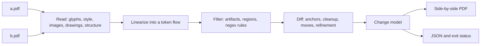

# abpdf design

This is the brief for the first implementation.
The research behind it is in [research/](research), and a working sketch of the approach is in [../prototype/](../prototype).

## Purpose

Given two revisions of a PDF, write a redline PDF that a reviewer can read page by page: the old page on the left, the new page on the right, and every change marked.
It replaces a commercial comparison service in a documentation build, so it must run unattended in CI as well as on a developer's machine.

## Requirements

Comparison:

- Compare the text as one continuous flow across pages.
  An insertion that pushes text onto later pages is one change, not a change on every following page.
- Ignore page furniture and text derived from pagination:
    - headers and footers
    - page references such as `(p. 351)`
    - table of contents leaders and page numbers
    - section, figure and table numbers
- Report changes to text, to text style (font, size, color, weight, slant, rotation), to images and to vector drawings.
- Report moved text as moved, not as a removal and an addition.

Output:

- A side-by-side PDF with the source pages embedded as vector content, never rasterized.
- Highlights on both sides, joined across the gutter by a connector.
- Only the sheets that show a difference, with a note for each skipped range ("Pages 1-23 have no differences").
- A summary page that lists every change and links to it, and a bookmark per change.
- A filter audit overlay: an option that outlines what each filter excluded, so a reviewer can trust the ignore rules.
- A machine-readable list of the changes (JSON).

Operation:

- One command, no server: `abpdf a.pdf b.pdf -o redline.pdf`.
- Exit status as `diff` uses it: 0 for no differences, 1 for differences, 2 for an error.
- Windows and Linux, offline.
- A document of several hundred pages in seconds.
- Deterministic: the same inputs give the same output bytes.
- Settings in a profile file that can be checked in next to the documents it applies to.
- Permissive license for the tool and everything it links.

## Non-goals

- A clean redline between the outputs of two different document generators.
  Two generators number, hyphenate and lay out the same content differently; abpdf should not crash or take long on such a pair, but its output will be noisy.
- Comparing scanned documents.
- An interactive viewer, for now.

## What the prototype established

Measured on two builds of a 383-page, 112,000-word document that differ by 14 known edits:

| Comparison of the two word streams | Change hunks |
| -- | -- |
| No filtering | 1,632 |
| Header and footer regions excluded | 592 |
| Plus regex filters for pagination-derived text | 24 |

The first two counts are from an earlier build of the pair that lacked part of one chapter.

- Of the hunks that remain, 18 are the edits and the rest are reflow artifacts, mostly table header rows repeated at a page break.
- Extraction, comparison and writing the redline took about 2 seconds.
- Text inside vector diagrams is compared like any other text when the producer draws labels as text.

What the prototype gets wrong is the first work list:

- An inserted image is not reported, only its caption.
- Repeated table headers at page breaks are reported as changes.
- Two swapped paragraphs are reported as a removal and an addition.
- It pairs an old page with a new page per change, which sometimes shows an unhelpful pair.
- Style-only changes are not detected.
- Punctuation stays attached to words, so `Export` and `Export.` differ as whole words.
- Words broken at a line end are not rejoined.

## Use what the producer already says

Tagged PDFs carry most of what the filters otherwise have to guess, and abpdf should read the structure tree and marked content whenever a document has them:

- Headers, footers and repeated table headers are marked as artifacts, so they can be dropped without region sizes.
- A paragraph that continues on the next page is one structure element.
- Headings, captions and table cells are typed, so a number-stripping rule can apply to headings and captions only.
- A soft hyphen (U+00AD) at a line end marks a word the producer broke.

Typst writes tagged PDFs by default since 0.14, and its `pdf.artifact` function lets a template mark further text, such as page references, as not content.
Untagged documents need the fallbacks: header and footer regions given in the profile or detected as text repeated across pages, and regex rules.
A structure tree from an unknown producer must be checked before it is trusted, for example that every piece of text outside an artifact is reachable from it.

## Architecture

The change model is the hub.
It lists each change with its kind (insert, delete, replace, move, style, image, drawing), the text on each side, and the pages and rectangles it covers.
Every output is rendered from it, and tests assert on it.

Tokens:

- A token is a word, a punctuation mark, or a figure (an image or a cluster of vector drawing treated as one unit).
- Each token keeps its page, its rectangles and its style, and a normalized key used for comparison: ligatures folded, invisible characters removed, words broken at line ends rejoined.
- A filtered token stays in the model, marked with the rule that excluded it, which is what the audit overlay draws.

Diff:

- Histogram diff over the token keys of the whole document.
- Cleanup that merges coincidental matches of a word or two inside a rewritten passage into one replacement.
- Moved blocks found by matching removed runs against added runs, allowing small differences.
- Character-level refinement inside short replacements.
- A figure is compared by identity first (same image data), then by rendering both and comparing pixels.

Sheets:

- Pair each new page with the old page that shares most of its unchanged tokens, and add sheets only where a change would otherwise have one side missing.

## Stack

| Part | Choice | Reason |
| -- | -- | -- |
| Language | Rust | One fast native binary per platform, and WebAssembly later for a viewer. |
| Reading | PDFium through `pdfium-render`, behind an interface | The only permissively licensed engine with per-glyph style, generated word spaces, and access to the structure tree and marked content. |
| Writing | `krilla` | Embeds source pages as vector content, draws overlays, bookmarks and links. |
| Diff | `imara-diff` | Histogram diff that stays near linear on long, mostly equal inputs. |
| Later | `hayro` as a second reader | Removes the PDFium shared library, for a single static binary. |

The reader sits behind an interface from the start so that a second implementation can be compared against the first in tests before it replaces it.

## Risks

- Two layouts of the same text can extract as different token sequences.
- PDFium is distributed as a shared library, so until `hayro` can replace it the release is an archive, not one file.
- The reader and the writer may disagree about page boxes or rotation, which would shift highlights.
- Embedding hundreds of source pages can make the output large and slow to write.
- Comparing vector drawings is noisy.
- `krilla` does not write comment annotations.
- `krilla` and `hayro` are young, and PDFium's editing interface is marked experimental.

## Testing

- The test corpus is generated in the repository: Typst sources for an old and a new revision of a synthetic document, each pair exercising named cases (reflow, renumbering, table edits, swapped paragraphs, changed image, changed diagram, style-only change).
  Nothing confidential or third-party is checked in.
- Tests assert on the change model, and a few on properties of the output PDF (pages stay vector, text stays extractable, links resolve).
- Each test pair is compared twice and the outputs must be byte-identical.
- A private corpus can be pointed at with an environment variable for local runs.
- CI runs on Windows and Linux.

## Order of work

1. Spike: read a tagged and an untagged PDF with PDFium into tokens; embed two pages side by side with `krilla` and draw on them.
   Settle the coordinate system and measure output size on a few hundred pages.
2. First usable version: continuous text diff, artifact, region and regex filters, side-by-side PDF with connectors, only changed sheets, summary page, JSON, exit status, profile file.
3. Filter audit overlay, moved blocks, repeated table headers, page pairing.
4. Figures, images and style changes; table cells.
5. `hayro` reader; release archives; packaging.
