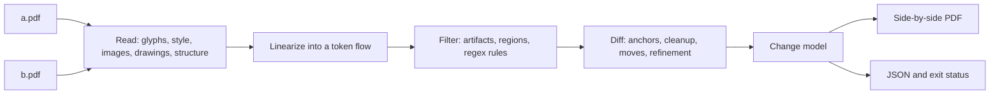

# abpdf design

This is the brief for the first implementation.
The research behind it is in [research/](research), and a working sketch of the approach is in [../prototype/](../prototype).

## Purpose

Given two revisions of a PDF, write a redline PDF that a reviewer can read page by page: the old page on the left, the new page on the right, and every change marked.
It replaces a commercial comparison service in a documentation build, so it must run unattended in CI as well as on a developer's machine.

## Requirements

Comparison:

- Compare the text as one continuous flow across pages.
  An insertion that pushes text onto later pages is one change, not a change on every following page.
- Ignore page furniture and text derived from pagination:
    - headers and footers
    - page references such as `(p. 351)`
    - table of contents leaders and page numbers
    - section, figure and table numbers
- Report changes to text, to text style (font, size, color, weight, slant, rotation), to images and to vector drawings.
- Report moved text as moved, not as a removal and an addition.

Output:

- A side-by-side PDF with the source pages embedded as vector content, never rasterized.
- Highlights on both sides, joined across the gutter by a connector.
- Only the sheets that show a difference, with a note for each skipped range ("Pages 1-23 have no differences").
- A summary page that lists every change and links to it, and a bookmark per change.
- A filter audit overlay: an option that outlines what each filter excluded, so a reviewer can trust the ignore rules.
- A machine-readable list of the changes (JSON).

Operation:

- One command, no server: `abpdf a.pdf b.pdf -o redline.pdf`.
- Exit status as `diff` uses it: 0 for no differences, 1 for differences, 2 for an error.
- Windows and Linux, offline.
- A document of several hundred pages in seconds.
- Deterministic: the same inputs give the same output bytes.
- Settings in a profile file that can be checked in next to the documents it applies to.
- Permissive license for the tool and everything it links.

## Non-goals

- A clean redline between the outputs of two different document generators.
  Two generators number, hyphenate and lay out the same content differently; abpdf should not crash or take long on such a pair, but its output will be noisy.
- Comparing scanned documents.
- An interactive viewer, for now.

## What the prototype established

Measured on two builds of a 383-page, 112,000-word document that differ by 14 known edits:

| Comparison of the two word streams | Change hunks |
| -- | -- |
| No filtering | 1,632 |
| Header and footer regions excluded | 592 |
| Plus regex filters for pagination-derived text | 24 |

The first two counts are from an earlier build of the pair that lacked part of one chapter.

- Of the hunks that remain, 18 are the edits and the rest are reflow artifacts, mostly table header rows repeated at a page break.
- Extraction, comparison and writing the redline took about 2 seconds.
- Text inside vector diagrams is compared like any other text when the producer draws labels as text.

What the prototype gets wrong is the first work list:

- An inserted image is not reported, only its caption.
- Repeated table headers at page breaks are reported as changes.
- Two swapped paragraphs are reported as a removal and an addition.
- It pairs an old page with a new page per change, which sometimes shows an unhelpful pair.
- Style-only changes are not detected.
- Punctuation stays attached to words, so `Export` and `Export.` differ as whole words.
- Words broken at a line end are not rejoined.

## What the spike established

The first step of the [order of work](#order-of-work) settled how positions are measured and what embedding costs, and showed what a tagged PDF says.

Positions:

- Every position is in page space: the page as a viewer shows it, with the crop box and the rotation applied, measured in PDF units from the top left corner with y growing downward.
- A page draws its text in PDF user space, and the visible box of the page and its rotation are all it takes to convert that.
- `krilla` embeds a page upright and starting at its crop box, so a mark at a token's bounds lands on the token.
  Tests hold this for the four rotations, with and without a crop box away from the origin, by reading the redline back.
- Neither side applies a page's `UserUnit`, so they agree on such pages too.

Cost, measured on the two revisions of the synthetic manual that `mise run manual` builds, each about 307 pages, 200,000 words and 3.8 MB:

| Stage | Result |
| -- | -- |
| Reading both documents into tokens | About 1 second |
| Writing every page of both, side by side on 307 sheets | 0.5 seconds |
| Size of those sheets | 3.9 MB |

- The sheets are smaller than the two sources together because fonts and images are embedded once per document and the structure tree is not embedded.
  From the same manual built without tags, at 1.9 MB per revision, they are 3.7 MB.
- Marks are not free: an outline around each of the 450,000 tokens adds 8 MB.

Tagged PDFs from Typst:

- Headers, footers, table of contents leaders, repeated table headers and text inside `pdf.artifact` all arrive marked as artifacts.
- The structure tree gives each token the types of the elements around it, such as `Document/Table/TBody/TR/TD`.
- A hyphen that ends a line inside a word is there because the producer broke the word, or because the text has it.
  Typst draws both kinds with one glyph, which maps to one of them, and names the other kind with `ActualText` wherever it occurs.
  So the kind of an unmarked hyphen follows from the marked hyphens of its font, and is unknown only in a font that has none and maps the glyph to the hyphen of the text.

Stack:

- A page can only be embedded in a PDF of at least its own version, so the redline is PDF 1.7 unless a source is newer.

## Use what the producer already says

Tagged PDFs carry most of what the filters otherwise have to guess, and abpdf should read the structure tree and marked content whenever a document has them:

- Headers, footers and repeated table headers are marked as artifacts, so they can be dropped without region sizes.
- A paragraph that continues on the next page is one structure element.
- Headings, captions and table cells are typed, so a number-stripping rule can apply to headings and captions only.
- A soft hyphen (U+00AD) at a line end marks a word the producer broke.

Typst writes tagged PDFs by default since 0.14, and its `pdf.artifact` function lets a template mark further text, such as page references, as not content.
Untagged documents need the fallbacks: header and footer regions given in the profile or detected as text repeated across pages, and regex rules.
A structure tree from an unknown producer must be checked before it is trusted, for example that every piece of text outside an artifact is reachable from it.

## Architecture

The change model is the hub.
It lists each change with its kind (insert, delete, replace, move, style), the text on each side, in which a figure reads as what it is, and the pages and rectangles it covers.
Every output is rendered from it, and tests assert on it.

Tokens:

- A token is a word, a punctuation mark, or a figure (an image, or a drawing that is treated as one unit).
- Each token keeps its page, its rectangles and its style, and a normalized key used for comparison: ligatures folded, invisible characters removed, words broken at line ends rejoined.
- A filtered token stays in the model, marked with the rule that excluded it, which is what the audit overlay draws.

Diff:

- Histogram diff over the token keys of the whole document.
- Cleanup that merges coincidental matches of a word or two inside a rewritten passage into one replacement.
- Moved blocks found by matching removed runs against added runs, allowing small differences.
- Character-level refinement inside short replacements.
- A figure is compared by what it is drawn with, which is its key, and then by the points it is drawn through, which are measured from the first of them so that its place on the page does not matter.

Sheets:

- Show a change as a whole on the pages where its two sides start.
- Show any other page that a change is on next to the page of the other document that shares most of its unchanged tokens, or alone if none shares any.
  Pairing the pages of a long change in order instead puts one page next to several that have nothing to do with it.

## Stack

| Part | Choice | Reason |
| -- | -- | -- |
| Language | Rust | One fast native binary per platform, and WebAssembly later for a viewer. |
| Reading | An interpreter of abpdf's own on `hayro-syntax` and `hayro-font` | Reports what a page draws as objects, with their fonts, marked content and forms, and leaves abpdf one binary. |
| Writing | `krilla` | Embeds source pages as vector content, draws overlays, bookmarks and links. |
| Diff | `imara-diff` | Histogram diff that stays near linear on long, mostly equal inputs. |

Two readers that are there to take were not enough:

- PDFium was the first reader.
  It is a shared library to load next to the program, it does not say what kind of artifact a shape is, and it reports a hyphen at a line end as a marker of its own.
  The reader of abpdf's own replaced it once both got the same out of the test corpus.
- The interpreter of `hayro` is made to render.
  Its interface does not say where a form starts and ends or which font dictionary a glyph is drawn with, and abpdf needs both: an included PDF is one figure, and the name of a Type 1 font is only in its dictionary.

## Risks

- Two layouts of the same text can extract as different token sequences.
- The reader is abpdf's own, so what it has not met in a PDF it may read wrongly.
- Where the producer does not mark its hyphens, whether a hyphen at a line end belongs to the word is a guess.
- Comparing vector drawings is noisy.
- `krilla` does not write comment annotations.
- `krilla` and the `hayro` crates are young.

## Testing

- The test corpus is generated in the repository: Typst sources for an old and a new revision of a synthetic document, each pair exercising named cases (reflow, renumbering, table edits, swapped paragraphs, changed image, changed diagram, style-only change).
  The PDFs built from the sources are checked in, so the tests need no Typst, and CI checks that they are up to date.
  Nothing confidential or third-party is checked in.
- Tests assert on the change model, and a few on properties of the output PDF (pages stay vector, text stays extractable, links resolve).
- Each test pair is compared twice and the outputs must be byte-identical.
- A private corpus can be pointed at with an environment variable for local runs.
- CI runs on Windows and Linux.

## Order of work

1. Spike: read a tagged and an untagged PDF with PDFium into tokens; embed two pages side by side with `krilla` and draw on them.
   Settle the coordinate system and measure output size on a few hundred pages.
   Done: see [What the spike established](#what-the-spike-established).
2. First usable version: continuous text diff, artifact, region and regex filters, side-by-side PDF with connectors, only changed sheets, summary page, JSON, exit status, profile file.
   Done: with a profile of three patterns, the two revisions of the synthetic manual differ by the 16 edits to their text and nothing else, which takes 1.4 seconds to find and to write as a redline.
3. Filter audit overlay, moved blocks, repeated table headers, page pairing.
   Done: the revisions of the test corpus differ by the same changes with and without tags, and the paragraphs that change places in them and in the synthetic manual are moves.
   Filtered tokens have a list of their own next to the compared ones.
   What a page repeats at its top is left out for its place and not for what it says, which also covers a running header that is the same on every page, but no footer.
4. Figures, images and style changes; table cells; detection of headers and footers in untagged documents.
   Done: the revisions of the synthetic manual differ by 19 changes, which are the 16 edits to their text, two to its style and an image with other pixels.
   - A header or a footer that nothing marks is found by its place, as a line at the top or the bottom of a page that a page nearby has too, so the untagged test corpus needs no heights in its profile.
   - Style is compared where the diff leaves text matched.
   - A figure is a token: an image, a form, or the shapes that the tag of one figure holds.
     Its points are compared apart from its key and with a tolerance, because a producer does not write a figure at another place on the page with the same numbers.
     Nothing is rendered.
   - A hunk of the diff is cut into the changes that it holds: around its figures, and from one table cell to the next where tags tell the cells apart.
   - A token knows where it stands among the tokens as they are read, so the area of a change ends where text that is left out stands in it.
   - Text in a form belongs to what is around the form: the marked content inside an included PDF is numbered apart from that of the page.
   - A page that its producer draws through one form reads as one figure with all of its shapes.
5. Drawings of loose shapes: the shapes that a page draws one by one, which is how a diagram arrives that is made with the drawing commands of Typst.
   Done: the revisions of the synthetic manual differ by 20 changes, of which the new one is the diagram in which a box changes, as one drawing.
   - One drawing is what a page draws in one go: shapes one after another, with nothing between them but text that stands in one of them.
     Shapes that touch are no measure of it, because a diagram has gaps and a box behind highlighted text touches nothing else.
   - A drawing is told from what rules and boxes text by its shapes: a thin shape is a rule and any other shape with text in it is a box of text, and a drawing has a shape that is neither or a rule that joins a box of text to something.
     Boxes of text alone are none, so that notes in frames one after the other are not taken for a diagram, at the price of a diagram that is nothing but labelled boxes.
     Typst marks the shapes of a diagram as layout artifacts, the same as the rules of a table, so its marks do not tell.
   - Tags tell two things: text in several table cells makes the shapes around it those of a table, and a shape that is marked as an artifact of pagination, of the page or of its background belongs to the page.
   - The rules take plain data: the bounds of the shapes and the middles and table cells of the texts.
6. A reader of abpdf's own in place of PDFium; release archives; packaging.
   Done: abpdf reads PDFs with an interpreter of its own and is one binary.
   It finds the same changes as with PDFium in the test corpus and in the synthetic manual, with and without tags, and a comparison of the manual takes 0.9 seconds where it took 1.8.
   - The reader reports text as it is printed, and the flow finds the hyphens that end a line inside a word, also at the end of a page.
     Ignore patterns see a word that a line break splits as one word with its hyphen, as `well-known`, and without it only where the producer marks the hyphen as no part of the word.
   - Where a word and a line end is told from where the glyphs stand, by three numbers that are shares of the font size: an eighth after the end of a glyph is a space, a tenth off the baseline is raised or lowered, and half off it is another line.
     Text is not sorted: it is read in the order in which the page draws it.
   - A glyph has the box that its font reserves for it, from the font descriptor, so a mark is as high as its line and no font program is parsed for it.
   - Colors are read to tell them apart and to name them: no color profile is applied, and inks are read as a gray.
   - Held against PDFium on 207 documents of a dozen producers that were at hand, among them pdfTeX, Word, LibreOffice, Apache FOP and Chrome, the reader differs in 2 of 1000 tokens.
     Most are spaces that PDFium does not find and indices that it does not set apart.
   - Not done: text that is drawn twice to look bold reads twice, and text that is written from the top down has a box of a guessed width.
   - The tag of a version builds its release: archives of the one binary for Linux, Windows and macOS, and conda packages for the same platforms.
     The binary for Linux is linked against musl, so that it runs on any Linux, which costs a third of its speed, and the one in the conda package is not.
   - A channel on prefix.dev is the short way to a package that pixi installs by its name, until abpdf is on conda-forge, which takes a public repository.
     Without a channel, pixi builds abpdf from its source.
